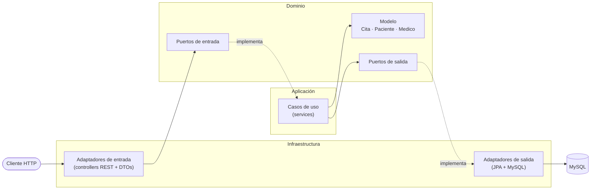

# CitasMedicas

API REST para agendar citas médicas, construida con **Java 21**, **Spring Boot** y **arquitectura hexagonal** (puertos y adaptadores). Proyecto de portafolio para practicar diseño de software, persistencia con JPA, pruebas automatizadas y contenedores con Docker.

## Arquitectura

El dominio no conoce ningún framework: solo define reglas de negocio e interfaces (puertos). Spring, JPA y HTTP viven en los adaptadores.



```
src/main/java/com/citasmed/citasmed
├── domain          # modelo, excepciones y puertos (Java puro)
├── application     # casos de uso
└── infrastructure
    └── adapter
        ├── in/web          # controllers REST y DTOs
        └── out/persistence # entidades JPA, mappers y adaptadores
```

Las reglas de esta arquitectura se verifican automáticamente con **ArchUnit** (por ejemplo, el dominio no puede importar Spring ni JPA): si alguien las rompe, el build falla.

## Reglas de negocio

- Una cita nueva nace en estado `PENDIENTE` y no puede agendarse en el pasado.
- Transiciones válidas: `PENDIENTE → CONFIRMADA → COMPLETADA`. Una cita puede cancelarse salvo que ya esté completada.
- Un médico no puede tener dos citas activas en el mismo horario (las canceladas no bloquean el horario).
- Una cita confirmada que ocurre en las próximas 24 horas requiere recordatorio.

## Endpoints

| Método | Ruta | Descripción |
|---|---|---|
| POST | `/api/pacientes` | Registrar paciente |
| POST | `/api/medicos` | Registrar médico |
| POST | `/api/citas` | Agendar cita |
| PATCH | `/api/citas/{id}/confirmar` | Confirmar cita |
| PATCH | `/api/citas/{id}/cancelar` | Cancelar cita |
| PATCH | `/api/citas/{id}/completar` | Completar cita |
| GET | `/api/citas/paciente/{idPaciente}` | Citas de un paciente |
| GET | `/api/citas/medico/{idMedico}` | Citas de un médico |

Ejemplo:

```bash
curl -X POST http://localhost:8080/api/pacientes \
  -H "Content-Type: application/json" \
  -d '{"nombre":"Ana Gomez","email":"ana@mail.com","telefono":"3001234567"}'
```

## Cómo ejecutarlo

Requisitos: Docker y Docker Compose.

```bash
cp .env.example .env      # y cambia DB_PASSWORD
docker compose up --build
```

La API queda en `http://localhost:8080` y MySQL en el puerto `3307` del equipo.

## Pruebas

```bash
./gradlew test
```

- **Unitarias** del dominio (`CitaTest`) y de los casos de uso con Mockito.
- **Integración** de la persistencia contra H2 en memoria, sin necesidad de Docker.
- **Arquitectura** con ArchUnit.

El pipeline de GitHub Actions (`.github/workflows/ci.yml`) corre `./gradlew build` en cada push y pull request.

## Estado y próximos pasos

- [x] Dominio, casos de uso, API REST y persistencia con MySQL
- [x] Docker Compose
- [x] Tests unitarios, de integración y de arquitectura + CI
- [ ] Migraciones versionadas con Flyway (hoy se usa `ddl-auto=update`)
- [ ] Recordatorios asíncronos: RabbitMQ + tarea programada + MailHog
- [ ] Autenticación con JWT y roles (paciente / médico)
- [ ] Documentación OpenAPI (Swagger)
- [ ] Frontend mínimo y despliegue

## Limitación conocida

La validación de disponibilidad del médico se hace en la capa de aplicación, por lo que dos peticiones simultáneas para el mismo horario podrían agendarse a la vez. Está pendiente protegerlo a nivel de base de datos.